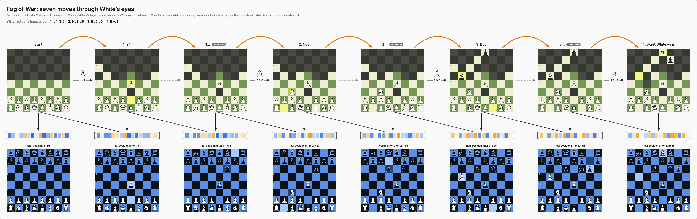
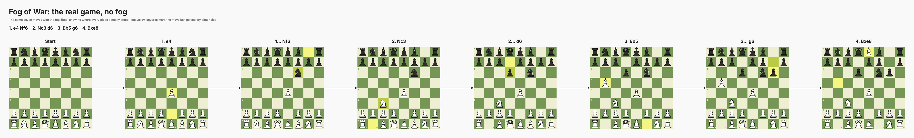

# Vellum

A minimal Figma-style vector editor that runs in the browser. There is no build step and no dependencies: three files (`index.html`, `core.js`, `app.js`) make up the whole app.

## What it does

- **Pages and layers.** A layers tree with show/hide and lock, reordering with ⌘[ and ⌘], and inline renaming.
- **Tools.** Move, hand, rectangle, ellipse, text and connector arrows, plus groups, sections and multi-path vector nodes.
- **Editing.** Double-click steps into a group, ⌘-click selects the deepest layer, marquee selection, resize handles, nudging, align, duplicate, copy and paste, undo and redo.
- **Properties panel.** Position, size, opacity, fill, stroke, corner radius, text (size, weight, line height, colour, alignment, wrapping) and connector settings.
- **Files.** Documents are plain JSON. Open and save from the File menu; the current document autosaves to `localStorage`.
- **Export.** The selection or the whole page as SVG or PNG. SVG exports can embed the Inter font so they render the same offline.
- **Annotations.** Sketches, arrows, highlights and sticky notes, in five colours, in their own "Annotations" layer on each page.
  - **Sketches.** While the pen is active, every stroke joins one sketch, so a drawing of several strokes is one annotation. Press Done or Esc to finish, or New sketch to start another. A sketch means "I want something like this" by default; switch it to "Points at something" when it just marks a spot.
  - **Arrows.** Ends stick to the layer under them: small layers snap to their centre, big ones keep the exact point. Hold Alt for a free end. Right-drag draws one from any tool.
  - **Highlights.** Click to highlight the most specific layer under the pointer, or drag to highlight an area. Right-click highlights from any tool.
  - **Combining.** Select several annotations and press ⌘G, or "Combine into one annotation", to make them one annotation with one thread.
- **Phones.** The tools move to a floating bar and two-finger pinch zooms.

## Run it locally

```bash
python3 tools/devserver.py 8765
```

Then open http://127.0.0.1:8765. The dev server serves the app and also accepts `POST /save?name=<file>` to write exports into `exports/`.

## Keyboard shortcuts

| Action | Keys |
| --- | --- |
| Move, hand | V, H |
| Rectangle, ellipse | R, O |
| Text, connector | T, C |
| Group, ungroup | ⌘G, ⇧⌘G |
| Duplicate | ⌘D |
| Bring forward, send backward | ⌘], ⌘[ |
| Hide, lock | ⇧⌘H, ⇧⌘L |
| Zoom to fit, zoom to selection, 100% | ⇧1, ⇧2, ⇧0 |
| Pen, arrow, highlight, note | P, A, M, N |
| Arrow, highlight from any tool | Right-drag, right-click |
| Combine selected annotations | ⌘G |
| Undo, redo | ⌘Z, ⇧⌘Z |

## Document format

```json
{
  "version": 1,
  "name": "Untitled",
  "pages": [
    { "id": "page-1", "name": "Page 1", "children": [
      { "id": "r1", "type": "RECT", "name": "Box", "x": 0, "y": 0, "w": 100, "h": 100, "fill": "#D9D9D9" }
    ] }
  ]
}
```

Every node has `id`, `type` and `name`, and uses absolute page coordinates. Node types:

- `RECT`, `ELLIPSE`: `x y w h fill fillOpacity stroke strokeWidth radius`
- `TEXT`: `x y text fontSize fontWeight color lineHeight align autoWidth w`, plus optional coloured `runs`
- `PATH`: `x y w h vw vh fill stroke detail strokeWidth paths[{d, role}]`, where role is `body`, `ink` or `dot`
- `GROUP`: `children` (bounds come from the children)
- `SECTION`: `x y w h fill stroke radius children`
- `CONNECTOR`: `from{id, side} to{id, side} label stroke strokeWidth dash arrow headSize`
- `INK`: `strokes[{points, stroke, strokeWidth}] stroke strokeWidth intent` (a sketch; `intent` is `mockup` or `mark`)
- `STICKY`: `x y w h text fill fontSize` (note; height grows with the text)

## Sharing annotations

When Vellum runs as a published Claude artifact, each page's annotations sync to the artifact's database as `annotations/<pageId>`. Every item carries an `about` line in plain language, such as "red arrow from square f6 on “Position 2” to square e4", so Claude can read what each mark points at. Run locally, annotations stay in the browser's autosave.

Each annotation is also a small thread. Select one to add follow-ups, then resolve it when the work is done; a follow-up on a resolved annotation reopens it. Resolved annotations are hidden from the canvas and from exports, and stay listed under Resolved in the side panel, where "Show on canvas" brings them back faded. In the shared data, items carry `status: "resolved"`, `resolvedBy` and a `replies` list of `{author, text, at}`, with `author` either `user` or `claude`, so Claude can post follow-ups and resolve items too.

## Code layout

- `core.js` holds the document helpers, text layout, bounds, SVG rendering and export. It has no DOM dependency apart from an injected text measurer, so the editor and headless exporters share it.
- `app.js` is the editor: state, pointer and keyboard handling, panels, history and files.
- `tools/devserver.py` is the local static server with the export save endpoint.

The browser console exposes `window.vellum` (`doc`, `selection`, `select`, `mutate`, `exportSVG`) for scripting.

## Sample: Fog of War boards

The editor opens with `samples/fog-of-war.json`, a seven-move Fog of War chess game drawn as Vellum layers. The game is `1. e4 Nf6 2. Nc3 d6 3. Bb5 g6 4. Bxe8`, where Black's moves are invisible to White and White ends it by capturing the king.

- **White's view.** Each position exactly as White sees it, with fogged squares where no White piece could move.
  - **Moves.** Arrows between boards carry each White move and the piece that moved; Black's hidden moves are plain dashed arrows.
  - **Next-state prediction.** Amber arcs over the top run from each fogged state to the next.
  - **Embeddings.** Under each board is a 16-value embedding vector, fed by an arrow from its own board and a diagonal arrow from the board before it. The values are illustrative, derived from what White can see, so they repeat after each hidden Black move.
  - **Real positions.** At the bottom, a blue-and-black board shows where every piece really stood.
- **Real positions.** The same seven moves on classic boards with the fog lifted.





The chess pieces are original vector drawings, so exports look the same on any machine.

### Regenerate the sample

```bash
python3 tools/build_fow.py
```

`tools/build_fow.py` plays the moves, works out which squares White can see under Fog of War rules (every pseudo-legal destination, with no check), and writes the document. Bump `SAMPLE_VERSION` when the sample changes; the editor then replaces an autosaved older copy and keeps the old one a single undo away.

### Re-export the images

With the dev server running, open http://127.0.0.1:8765/export.html?preset=fow. It renders each board and both full rows in the browser, then saves SVG and PNG files into `exports/`.
