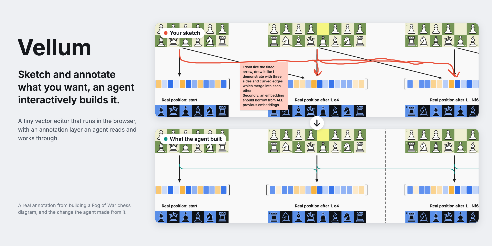

# Vellum



Vellum is a small vector editor that runs in the browser: three files, no build step and no dependencies. You draw diagrams, export them as SVG or PNG, and mark them up with sketches and notes that an agent reads and works through.

## Features

- **Diagrams.** Rectangles, ellipses, text, vector paths, images and connector arrows, organised in pages, layers, groups and sections.
- **Annotations.** Sketch what you want, point with arrows, highlight layers and leave notes, all in their own layer. Each annotation is a small thread you can reply to and resolve.
- **Readable by agents.** Synced annotations carry a plain-language description of what each one points at, so an agent knows what a mark refers to.
- **Export.** Export a selection or a whole page as SVG, with the Inter font embedded, or as PNG. A batch exporter renders many at once.
- **Plain JSON documents.** They are easy to generate from a script and easy to diff.

## Quick start

```bash
git clone https://github.com/arpan-dasgupta/vellum.git
cd vellum
python3 tools/devserver.py 8765
```

Then open http://127.0.0.1:8765. Python 3 is the only requirement.

## Working with an agent

1. **Mark up the diagram.** Sketch what you want with the pen (P), point with arrows (A) and highlights (M), and write instructions in notes (N).
2. **Ask your agent to work on the annotations.** The agent looks at each annotation on its own, as an image, and makes the change. Then it replies on the annotation and resolves it.
3. **Answer questions on the annotation.** If something is unclear, the agent asks there and leaves the annotation open. Reply on it to continue.

Annotations are saved inside the document's JSON, so any agent that can read files can work on them.

The full loop of syncing, replies and resolving runs when Vellum is published as a Claude artifact. There, annotations sync to the artifact's database with their plain-language descriptions, and Claude reads them, replies and resolves them.

[CLAUDE.md](CLAUDE.md) is the step-by-step guide. It is written for Claude Code, but the steps carry over to other agents.

The cover shows a real round. The note and red sketch asked for a three-sided rail with rounded corners instead of tilted arrows. The panel below shows what the agent built.

## Example: Fog of War

[`diagrams/fog-of-war`](diagrams/fog-of-war/README.md) is a complete diagram made with Vellum. It draws a Fog of War chess game to show how a model plays with hidden information. A Python script generates it, and it was shaped through about thirty annotations.


## Repository layout

| Path | What it holds |
| --- | --- |
| `index.html`, `core.js`, `app.js` | The editor |
| `export.html` | Batch export and annotation review |
| `tools/` | The dev server and a GIF packer |
| `vellum.config.json` | Which document opens first |
| `diagrams/` | Diagrams made with Vellum, one self-contained folder each |
| `docs/` | The [reference](docs/reference.md) and images |

The editor never refers to a diagram. Anything specific to one diagram lives in its own folder.

## License

[MIT](LICENSE)
